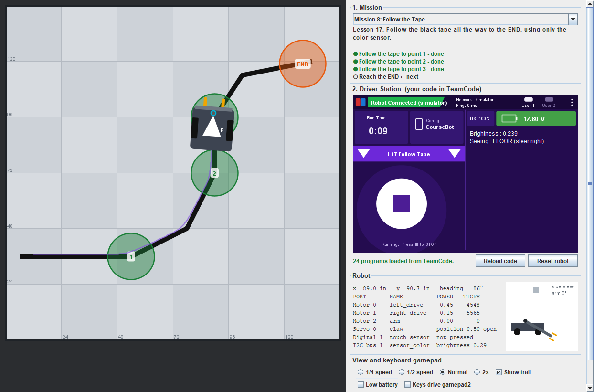
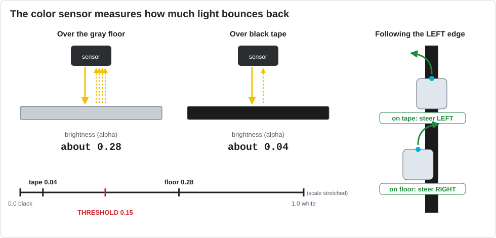

# Lesson 17 — Color Sensor: Find and Follow Black Tape

> **You will learn:** how a color sensor measures light, how to turn a sensor number into a
> decision with a **threshold**, and how to follow a line of tape.
> **You need:** the drive motors and a REV Color Sensor V3 named `sensor_color`, mounted at the
> front of the robot looking down, about 1 cm above the floor
> ([where it plugs in](../reference/robot-configuration.md)). Black tape on the floor. No robot
> handy? Use the [simulator](../simulator.md).
> **Time:** about 45 minutes · **Program type:** Autonomous
> **Code:** [`L17_StopAtTape.java`](../../TeamCode/src/main/java/org/firstinspires/ftc/teamcode/lessons/L17_StopAtTape.java) and [`L17_FollowTape.java`](../../TeamCode/src/main/java/org/firstinspires/ftc/teamcode/lessons/L17_FollowTape.java)

## Before you start
1. **Pull** in GitHub Desktop.
2. **Copy both** `L17_StopAtTape.java` and `L17_FollowTape.java` into your `students/yourname` folder.
3. In each copy, give it a unique `name` and **delete `@Disabled`**.

[Forgot how? Lesson 00, Step 7 has pictures.](00-getting-the-code.md#step-7--copy-your-first-lesson)

## 🖥️ No robot? Use the simulator
This lesson runs in the [Robot Simulator](../simulator.md), on any laptop or at home.
- Picking `L17_StopAtTape` opens **Mission 7: Stop at the Tape**. The tape **moves to a new
  spot every time you press Reset robot**, so a timer can't solve it.
- Picking `L17_FollowTape` opens **Mission 8: Follow the Tape**.
- The Robot panel shows `sensor_color`'s brightness all the time, and the sensor's dot on the
  robot turns dark over the tape.
- When you finish this lesson, pick **Mission 7** or **8** yourself: each has its own program
  with two bugs to fix ([More missions](../missions.md#more-missions-after-the-lessons)).



---

## 📖 Learn it

### What the sensor measures
A color sensor shines its own light at the floor and measures how much bounces back. Black
tape soaks up almost all the light. Gray tiles bounce back more.



The code reads the sensor like this:
```java
NormalizedColorSensor colorSensor = hardwareMap.get(NormalizedColorSensor.class, "sensor_color");
NormalizedRGBA colors = colorSensor.getNormalizedColors();
double brightness = colors.alpha;     // 0.0 = black ... 1.0 = white
```
`NormalizedRGBA` holds four numbers: `red`, `green`, `blue`, and `alpha`. **Alpha** is the
overall brightness, which is all we need for black tape.

Two settings matter:
- **Gain** (`colorSensor.setGain(15)`) makes every reading brighter, like turning up the volume.
  Change the gain, and every number changes.
- **The sensor's light** (`enableLight(true)`) makes readings not depend on the room's lights.

### A threshold turns a number into yes/no
Your sensor gives a number, but your program needs a decision: *tape or floor?* Pick a
**threshold** halfway between the two readings:

| Surface | Brightness (example) |
|---|---|
| Gray floor | 0.28 |
| Black tape | 0.04 |
| **Threshold** (halfway) | **(0.28 + 0.04) ÷ 2 = 0.16** |

Brighter than the threshold means floor. Darker means tape. Every floor, tape, and sensor is a
little different, so **measure yours** before trusting a number.

### Watching the sensor before START
Part 1 uses a new kind of loop instead of `waitForStart()`:
```java
while (opModeInInit()) {      // true after INIT, until START is pressed
    telemetry.addData("Brightness", "%.3f", getBrightness());
    telemetry.update();
}
```
While it runs, you can hold the robot over the floor, then over the tape, and read both numbers.

### Following a line: ride the EDGE
Part 2 doesn't try to stay in the middle of the tape. It follows the tape's **left edge**:
- sees **tape** (dark) → drifted too far right → steer **left**
- sees **floor** (bright) → drifted too far left → steer **right**

Checking and correcting dozens of times every second, the robot wiggles along the edge
wherever the tape goes. This "check, then correct" loop is the core idea of all robot control.

---

## Part 1: Stop at the tape (`L17_StopAtTape`)

### 1. Predict
1. Which reading is bigger, the floor or the tape?
2. What will the robot do if `BLACK_THRESHOLD` is `0.5`? What if it's `0.01`?

### 2. Run
Run it a few times. In the simulator, press **Reset robot** between runs so the tape moves.
Write down the brightness while driving (floor) and when it stops (tape).

### 3. Investigate
1. Why does the program still work when the tape moves, while a program using `sleep()` wouldn't?
2. Change `setGain(15)` to `setGain(5)`. What happens to the floor reading? Does your threshold still work?
3. Change `enableLight(true)` to `enableLight(false)`. What happens to the readings?
4. Change `DRIVE_POWER` to `1.0`. Does the robot still stop **on** the tape? Why or why not?

<details><summary>💡 Hint for #2</summary>

With less gain, the floor reads darker, maybe darker than your threshold. Then what does the
program think it's seeing as soon as it starts?

</details>

<details><summary>💡 Hint for #4</summary>

A faster robot needs more distance to stop. The tape is only 2 inches wide.

</details>

### 4. Modify
1. Use your measured floor and tape numbers to set `BLACK_THRESHOLD` exactly halfway.
2. After finding the tape, back up for half a second (use what you learned in Lesson 10).

---

## Part 2: Follow the tape (`L17_FollowTape`)

### 1. Predict
1. The robot starts with its sensor on the left edge of the tape. What will the telemetry say most of the time?
2. What would happen if it started on the **right** edge instead?

### 2. Run
Run it. Turn on **Show trail** in the simulator to see the wiggle.

### 3. Investigate
1. Set `STEER_POWER` to `0.05`. What happens on the curves?
2. Set `STEER_POWER` to `0.3`. What happens to the wiggle?
3. Make `BASE_POWER` bigger. What's the fastest speed that still finishes?

<details><summary>💡 Hint for #1</summary>

When the tape curves, the robot has to turn as much as the tape does. A small steer can't turn
fast enough.

</details>

### 4. Modify
Make it follow the **right** edge of the tape instead. *(Which two lines swap?)*

### 5. Make: Smooth following
The robot only knows two answers: *tape* or *floor*. But on the edge, the sensor reads
in-between numbers. Use **how far** the reading is from the edge value to decide **how much** to steer:
```java
double error = brightness - 0.16;    // positive = on the floor, negative = on the tape
double turn = K * error;
double leftPower = BASE_POWER + turn;
double rightPower = BASE_POWER - turn;
```
Try different numbers for `K`. This is called **proportional control**, and FRC and FTC teams use
it everywhere: for arms, for driving straight, and for aiming.

<details><summary>💡 Hint</summary>

Start with `K = 2`. If it can't keep up on the curves, make K bigger. If it wiggles a lot, make
it smaller.

</details>

---

## ✅ Check yourself
- [ ] I can read the color sensor's brightness and show it on telemetry.
- [ ] I can measure the floor and the tape, and set a threshold halfway.
- [ ] I can explain why a sensor works when a timer can't.
- [ ] I can explain how the robot follows the edge of a line.

**Exit ticket:** Your robot stops at the tape on your practice field but drives right past it at
another school. Name two things that could be different, and how you'd fix the program.

## 🆘 Stuck?
| Problem | Try this |
|---|---|
| *Unable to find a hardware device "sensor_color"* | Add it to the robot configuration: I2C bus 1, REV Color Sensor V3 ([how](../reference/robot-configuration.md)). |
| Robot doesn't move at all | The threshold is higher than your floor reading, so the program thinks it's already on the tape. Measure again. |
| Robot drives past the tape | The threshold is lower than the tape reading, the robot is too fast, or the sensor is too high above the floor. |
| Line follower spins in circles | It started on the wrong edge, or `STEER_POWER` is too big. |
| Line follower runs off the tape on curves | `STEER_POWER` is too small, or `BASE_POWER` is too fast. |

---
<!-- lesson-nav -->
[← Lesson 16: Robot Class: Autonomous](16-robot-class-auto.md) · [All lessons](../START-HERE.md#lessons) · [Lesson 18: Capstone →](18-grand-challenge.md)
