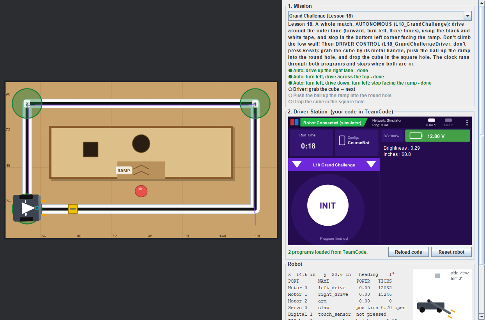

# Lesson 18 — Capstone: Your Robot, Your Code

> **You will:** set up a robot configuration yourself, write your own robot class starting from an
> almost empty file, and combine everything from Lessons 01–17 into **a whole match**: an autonomous
> program and a driver-control program that share your robot class.
> **You need:** everything: drive motors, arm, claw, touch sensor (as the front bumper), and
> color sensor. No robot handy? The [simulator](../simulator.md) has all of it.
> **Time:** 4–5 class periods · **Program type:** Autonomous and TeleOp
> **Code:** [`MyRobot.java`](../../TeamCode/src/main/java/org/firstinspires/ftc/teamcode/lessons/MyRobot.java), [`L18_GrandChallenge.java`](../../TeamCode/src/main/java/org/firstinspires/ftc/teamcode/lessons/L18_GrandChallenge.java), and [`L18_GrandChallengeDriver.java`](../../TeamCode/src/main/java/org/firstinspires/ftc/teamcode/lessons/L18_GrandChallengeDriver.java) (all nearly empty, on purpose)

This lesson is different. There's no finished program to read and change: **you** build it. The
steps below tell you *what* to build and *in what order*. The *how* is up to you, and every
part links back to the lesson that taught it.

## Before you start
1. **Pull** in GitHub Desktop.
2. **Copy all three** (`MyRobot.java`, `L18_GrandChallenge.java`, `L18_GrandChallengeDriver.java`)
   into your `students/yourname` folder.
3. In your copies of both programs, give each a unique `name` and **delete `@Disabled`**.

[Forgot how? Lesson 00, Step 7 has pictures.](00-getting-the-code.md#step-7--copy-your-first-lesson)

## 🖥️ No robot? Use the simulator
- Picking `L18_GrandChallenge` opens the **Grand Challenge** (the last field in the mission list).
  Picking your driver program afterward keeps the same match going.
- Make your own configuration with **⋮ → Configure Robot** (Part 1).
- When you go back to other lessons, **Activate CourseBot** again. Lessons 01–17 use its names.

---

## Part 1: Set up your robot (configuration)
On a real team, someone decides what every device is called, and everyone else's code depends
on it. This time, that's you.

1. Open **Configure Robot** (the Driver Station's **⋮** menu, or the simulator's **Config** tile)
   and press **New**.
2. Add every device your robot needs for the challenge: two drive motors, the arm motor, the
   claw servo, the touch sensor, and the color sensor.
3. Pick your **own** names. They don't have to match CourseBot.
4. **Save** it with your name (for example `AvaBot`) and **Activate** it.

**The standards** (a teammate or your teacher checks these before you go on):
- [ ] Every name is lowercase, with `_` between words, and no spaces.
- [ ] Every name says what the device **does** (`lift_motor`, `front_bumper`), not what it is (`motor2`, `sensor`).
- [ ] No two devices have the same name.
- [ ] Every device is on the port it's really plugged into. In the simulator, the wiring is
      fixed: see [the course robot table](../reference/robot-configuration.md#the-course-robot).
      Names are yours; ports aren't!

**Fill in your configuration sheet.** You'll need it for Part 2.

| Port | Device type | Your name |
|---|---|---|
| Motor 0 | | |
| Motor 1 | | |
| Motor 2 | | |
| Servo 0 | | |
| Digital 1 | | |
| I2C bus 1 | | |

<details><summary>💡 Hint: the touch sensor won't press</summary>

A REV Touch Sensor in the port marked 0-1 is configured as **digital port 1**, not 0.

</details>

---

## Part 2: Build your robot class (`MyRobot.java`)
Open your copy of `MyRobot.java`. It has three empty sections. Fill them in, testing as you go.

### 1. Devices
One `private` field for each device in your configuration.
[Lesson 15](15-robot-class-teleop.md) did this in `RobotHardware.java`.

### 2. `init()`
- [ ] One `opMode.hardwareMap.get(...)` per device, using **your configuration's names**.
- [ ] Reverse the motor that needs it, so positive power drives both wheels forward ([Lesson 02](02-drive-sequence.md)).
- [ ] Set the drive motors to `BRAKE` and reset their encoders ([Lesson 12](12-encoder-drive.md)).
- [ ] Set up the color sensor: gain and light ([Lesson 17](17-color-sensor.md)).
- [ ] Start with the claw **open**.

### 3. Skills
One method per skill. You need **at least** these. Name them however you like:

| Skill | Hint | Learned in |
|---|---|---|
| Drive an exact distance, forward or back | Encoders, `RUN_TO_POSITION` | [12](12-encoder-drive.md), [16](16-robot-class-auto.md) |
| Turn about 90° left or right | Encoders, wheels in opposite directions | [16](16-robot-class-auto.md) |
| Open and close the claw | Servo positions, then wait | [13](13-toggle.md) |
| Raise the arm partway | Power for a short time, then `BRAKE` | [08](08-sensors-and-logic.md) |
| Drive until the color sensor sees black tape | A `while` loop with a sensor condition | [17](17-color-sensor.md) |
| Drive until the bumper touches something | A `while` loop with a touch sensor, **plus a time limit** | [10](10-timer-auto.md) |
| Follow the tape for a distance | Steer by brightness, count inches with encoders | [17](17-color-sensor.md), [12](12-encoder-drive.md) |

For **driver control**, add skills that **don't wait** (no `sleep`), so your loop keeps reading the
gamepad:

| Skill | Hint | Learned in |
|---|---|---|
| Drive with two powers (or forward and turn) | Just `setPower`, no waiting | [05](05-tank-drive.md), [06](06-arcade-drive.md), [15](15-robot-class-teleop.md) |
| Set the arm's power | Never up while it's at the top | [07](07-buttons-and-if.md), [08](08-sensors-and-logic.md) |
| Open or close the claw | One method with a `boolean`, or two methods | [13](13-toggle.md) |

<details><summary>💡 Hint: what does a skill method look like?</summary>

The same shape as the methods in Lessons 11 and 16:
```java
public void closeClaw() {
    claw.setPosition(0.3);
    opMode.sleep(500);     // give the servo time to move
}
```
Inside `MyRobot`, use `opMode.sleep(...)`, `opMode.opModeIsActive()`, and `opMode.telemetry`.

</details>

<details><summary>💡 Hint: every "until" loop needs a way out</summary>

What if the sensor never sees the tape? Your robot drives forever. Give every `while` loop a
timer too, like Lesson 10:
`while (opMode.opModeIsActive() && !touched && timer.seconds() < 5)`

</details>

---

## Part 3: Test one skill at a time
Don't write the whole challenge and hope! Test each skill **by itself** first.

1. In `L18_GrandChallenge`, after `waitForStart()`, call **one** skill. Run it. (Test the
   driver skills in `L18_GrandChallengeDriver`.)
2. Does it do exactly what you expect? Use telemetry to show numbers (ticks, brightness).
3. When it works, test the next skill. **Commit** after each one that works.

In the simulator, pick **Free Drive** to test without the challenge's goals. The Robot panel
shows every device's port and your configuration's names.

---

## Part 4: The Grand Challenge
A whole match, like a real FTC match: an **autonomous** period, then **driver control**.



**The field:** a long table with an outer lane around a raised platform. The lane has tape down
the middle: a black stripe with white on both sides. A low wall runs along the inside edge of the
lane: don't cross it! In the middle, a ramp leads up onto the platform, which has a **square hole**
(for the cube) and a **round hole** (for the ball).

### Part 4a: Autonomous (`L18_GrandChallenge`)
No gamepad, no help. The robot starts at the bottom-right edge, facing up the lane.

1. **Forward** up the right lane, then **turn left**.
2. **Forward** across the top, then **turn left**.
3. **Forward** down the left lane, then **turn left**, so the robot faces the ramp lane.

Use the tape: [Lesson 17](17-color-sensor.md) taught you to follow the edge of a line.

### Part 4b: Driver control (`L18_GrandChallengeDriver`)
When the autonomous ends, pick your driver program and press **INIT**, then **START**. **Don't
press Reset**: the match keeps going from where your autonomous stopped.

4. **Grab the cube** by its metal handle.
5. **Push the ball** up the ramp and into the **round hole**.
6. **Drop the cube** into the **square hole**.

The clock counts your autonomous and your driving (not the break in between) and **stops when
both are in**. The Mission panel checks off each step.

Your driver program uses the **same** `MyRobot` class. Add skills that **don't wait**, like
Lesson 15's: set the drive power, set the arm power, open or close the claw. Then the loop is short:
read the gamepad, call a skill.

### Plan first
Before you write any code, write your plan as comments in both programs: one line per step, in
plain English. Then turn each comment into a call to one of your skills.

<details><summary>💡 Hint: the robot drifts into the wall on the long side</summary>

Encoders alone aren't perfect: one wheel is always a little faster, and over 12 feet that adds up.
That's what the tape is for. Follow its edge with the color sensor (Lesson 17), and use the
encoders only to know **how far** you've gone.

</details>

<details><summary>💡 Hint: the robot hits the wall when it turns in a corner</summary>

A robot needs room to spin: its corners swing out further than its sides. Stop in the **middle**
of the corner, not past it. Is your robot coasting a few inches after it stops?

</details>

<details><summary>💡 Hint: after a turn, the line follower goes the wrong way</summary>

Line following works on **one edge** of the black line. After the turn, is the sensor on the
black, or past it, on the white? Stopping a little before the corner helps.

</details>

<details><summary>💡 Hint: the ball rolls off to the side</summary>

Push it from **straight behind**, and slowly (a slow-mode button helps). If it starts to slide
off, steer **toward** the ball to keep it in front. On the ramp, keep pushing: if you stop, it
rolls back down.

</details>

<details><summary>💡 Hint: the driver program starts the goals over</summary>

You pressed **Reset robot**, or ran the autonomous again. Run the autonomous, then pick the driver
program and press INIT, with no reset in between.

</details>

### Levels
| Level | You did it when... |
|---|---|
| 🥉 Bronze | Your autonomous gets all the way around the lane (steps 1–3). |
| 🥈 Silver | Bronze, plus one object in its hole. |
| 🥇 Gold | Both objects in: the clock stops. |
| 🏆 Platinum | Gold in under **2:30** (a real FTC match: a 30-second autonomous, then 2 minutes of driving), and your autonomous follows the tape so it works **5 times in a row**. |

### On the real robot
The class field is about 4 × 10 feet with lanes about 18 inches wide. The simulator's field is a
little bigger so CourseBot (18 × 18 inches) fits, so **measure** your real lanes and tune your
distances, turns, and tape threshold. That's normal ([Lesson 17](17-color-sensor.md) explains why).
On the real robot, your 3D-printed part can hook the cube's metal handle or push the ball: in the
simulator, CourseBot's claw grabs the cube and its front pushes the ball.

---

## ✅ Check yourself
- [ ] I made a robot configuration with my own names, and my code uses them.
- [ ] I wrote a robot class from an empty file: fields, `init()`, and skill methods.
- [ ] I tested each skill by itself before combining them.
- [ ] My autonomous uses encoders and the color sensor, each where it fits best.
- [ ] My autonomous and my driver program share one robot class.

**Reflection:** Which step was hardest, and why? Which lesson helped the most? If you had one
more week, what would you add to your robot class?

## 🆘 Stuck?
| Problem | Try this |
|---|---|
| *Unable to find a hardware device* | The name in quotes doesn't match **your active** configuration. Check your configuration sheet, and check which configuration is active. |
| Other lessons stopped working | They use CourseBot's names. **Activate CourseBot** when you go back to them. |
| The robot drives backwards or spins | Is the right motor reversed? Are left and right swapped in your configuration? |
| The robot never stops at the tape | Show the brightness on telemetry. Is your threshold between the floor and tape readings? Did you set the gain? |
| The robot drives into the wall forever | The touch sensor is on the wrong port in your configuration, or your loop never checks it. Add a time limit too. |
| The program ends instantly | `L18_GrandChallenge` is empty after `waitForStart()`, or a `while` loop's condition is false from the start. |
| The driver program doesn't react to the keys | Is everything inside `while (opModeIsActive())`? Does a skill you call use `sleep`? |
| The arm won't go up in driver control | At the top, the arm presses the touch sensor (Lesson 08). Is your `if` checking the right thing? |

---
<!-- lesson-nav -->
[← Lesson 17: Color Sensor](17-color-sensor.md) · [All lessons](../START-HERE.md#lessons) · [Back to Start Here →](../START-HERE.md)
