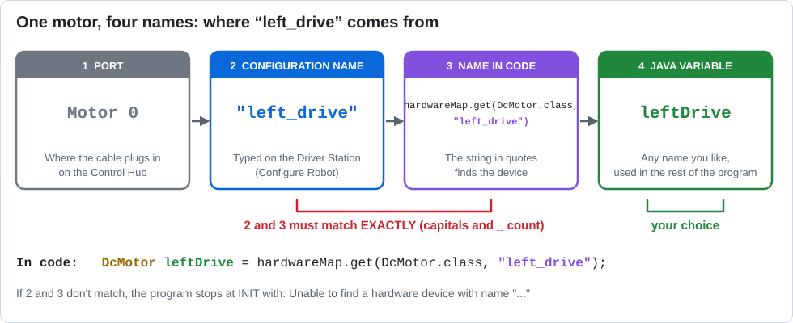
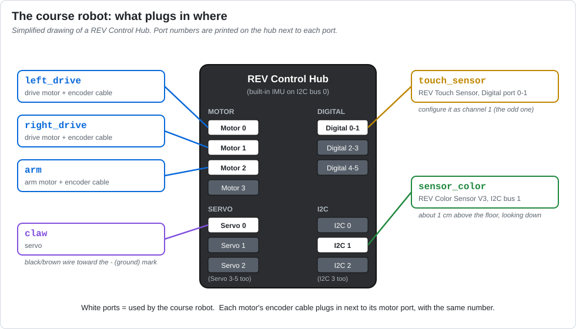
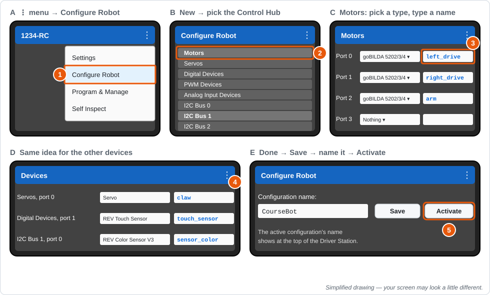
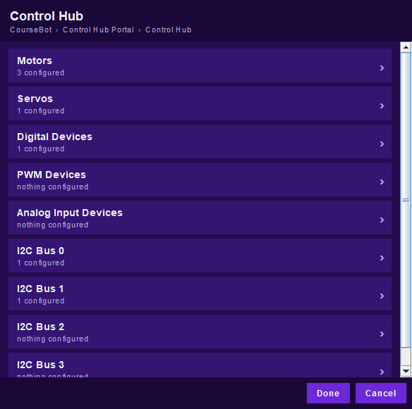
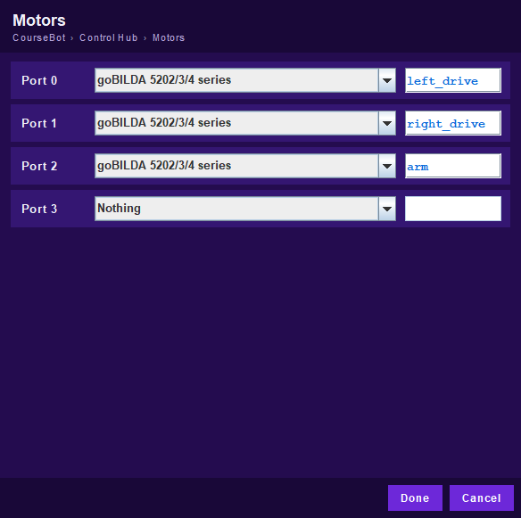

# Robot Configuration: Where the Names Come From

Every program starts with lines like this:
```java
DcMotor leftDrive = hardwareMap.get(DcMotor.class, "left_drive");
```
Where does `"left_drive"` come from? Why does the program crash at INIT when it's misspelled?
This page explains how a device gets from a cable on the Control Hub to a variable in your code.

---

## One device, four names


| # | Name | Who picks it | Example |
|---|---|---|---|
| 1 | **Port**: where the cable plugs in | Whoever wires the robot | Motor port 0 |
| 2 | **Configuration name**: what that port is called | Whoever makes the configuration on the Driver Station | `left_drive` |
| 3 | **Name in code**: the string in quotes | You, but it **must match #2 exactly** | `"left_drive"` |
| 4 | **Java variable**: what the rest of your program calls it | You, any name you like | `leftDrive` |

The **robot configuration** is a list saved on the Control Hub that connects #1 to #2: *"the
motor on port 0 is called left_drive."* When your program runs
`hardwareMap.get(DcMotor.class, "left_drive")`, the Control Hub looks up `left_drive` in that
list and hands back the motor on port 0.

If #2 and #3 don't match (`"Left_Drive"`, `"left drive"`, `"leftdrive"`), the lookup fails and the
program stops at INIT with *Unable to find a hardware device with name "..."*. The
[simulator](../simulator.md) gives the same error, plus a list of the names in its configuration.

---

## The course robot
Every lesson uses this configuration. Wire the robot (or [bench board](../README.md#the-bench-board)) like this:



| Port on the Control Hub | Device | Type to pick in the configuration | Configuration name | Get it in code with | Used in |
|---|---|---|---|---|---|
| Motor 0 | Left drive motor (+ encoder cable) | your motor model, e.g. *goBILDA 5202/3/4 series* | `left_drive` | `DcMotor` | L02, L05–L07, L09–L12, L14–L17 |
| Motor 1 | Right drive motor (+ encoder cable) | same as above | `right_drive` | `DcMotor` | same |
| Motor 2 | Arm motor (+ encoder cable) | your motor model | `arm` | `DcMotor` | L08, L15–L16 |
| Servo 0 | Claw servo | *Servo* | `claw` | `Servo` | L13, L15–L16 |
| Digital 0-1 (configured as **1**) | REV Touch Sensor | *REV Touch Sensor* | `touch_sensor` | `TouchSensor` | L08, L10, L14–L16 |
| I2C bus 1 | REV Color Sensor V3, looking down | *REV Color Sensor V3* | `sensor_color` | `NormalizedColorSensor` | L17 |

**Wiring tips**
- **Motors:** the power cable goes in the motor port, and the encoder cable goes in the encoder
  port **with the same number**. Without the encoder cable, encoder drive (Lesson 12) won't work.
- **Servos:** the black (or brown) wire goes toward the **−** (ground) mark on the hub.
- **Touch sensor:** REV digital ports carry two channels (0-1, 2-3, ...). The REV Touch Sensor
  uses the **second** one, so a sensor in port 0-1 is configured as **digital device 1**.
- **Color sensor:** I2C bus 0 is already used by the Control Hub's built-in IMU, so the color
  sensor goes on **bus 1**. Mount it at the front of the robot, looking straight down, about
  1 cm (½ inch) above the floor.

---

## Make the configuration on the Driver Station
You do this once per Control Hub. After that, everyone's programs use it.



1. Turn on the robot and connect the Driver Station. Open the **⋮** menu and choose **Configure Robot**.
2. Choose **New**, then pick the **Control Hub** from the list. You'll see a list of device types.
3. Choose **Motors**. For ports 0, 1, and 2, pick the motor model and type the names
   `left_drive`, `right_drive`, and `arm`. Press **Done**.
4. Do the same for the other devices:
   - **Servos**, port 0: *Servo*, named `claw`
   - **Digital Devices**, port 1: *REV Touch Sensor*, named `touch_sensor`
   - **I2C Bus 1**: **Add**, *REV Color Sensor V3*, named `sensor_color`
5. Press **Done** until you're back at the top, then **Save**. Name the configuration (for example
   `CourseBot`) and **Activate** it. Its name appears at the top of the Driver Station.

**Naming rules that save headaches:** all lowercase, words joined with `_`, no spaces, and a
name that says what the device *does* (`arm`, not `motor2`).

---

## In code: one `hardwareMap.get` per device
```java
DcMotor leftDrive  = hardwareMap.get(DcMotor.class, "left_drive");
DcMotor rightDrive = hardwareMap.get(DcMotor.class, "right_drive");
DcMotor arm        = hardwareMap.get(DcMotor.class, "arm");
Servo claw         = hardwareMap.get(Servo.class, "claw");
TouchSensor touch  = hardwareMap.get(TouchSensor.class, "touch_sensor");
NormalizedColorSensor colorSensor = hardwareMap.get(NormalizedColorSensor.class, "sensor_color");
```
The part before `.class` is the **type** of device you expect. Ask for the wrong type (like
`Servo.class, "arm"`) and you get the same "Unable to find" error.

**Renaming a device?** You'd have to change the string in **every** file that uses it. That's one
reason the `RobotHardware` class in Lesson 15 is so useful: the names live in one place.

---

## Adding a device to your own robot
1. Plug it into a free port of the right kind (motor, servo, digital, analog, or I2C).
2. Edit the configuration (**⋮ → Configure Robot → Edit**), pick the device type on that port,
   and give it a clear name. **Save** and make sure it's still active.
3. In code, add one `hardwareMap.get(...)` line with the matching type and name.

The simulator only has the six devices in the table above. Code for any other device should go in
a folder named `robotonly`, so the simulator skips it ([details](../simulator.md#whats-different-from-the-real-robot)).

---

## Practice in the simulator
The simulator has the same **Configure Robot** screens as the Driver Station, so you can practice
making a configuration (and see what goes wrong when it's wrong) without a robot.

Open them from the Driver Station panel: **⋮ → Configure Robot**, or click the **Config** tile.

| Driver Station screen | What you do there |
|---|---|
| **Configure Robot** | Your saved configurations. **Edit**, **Activate**, **Delete**, or **New**. The active one is green. |
| **USB Devices** → **Control Hub Portal** → **Control Hub** | Click your way down to the hub. **Save** is on the USB Devices screen. |
| **Control Hub** | One row for each kind of port: Motors, Servos, Digital Devices, ... I2C Bus 0–3. |
| **Motors**, **Servos**, ... | For each port, pick a type and type a name. **Done** goes back up. |




The simulated robot is **wired** like the course robot (the table at the top of this page). The
configuration only decides what each port is **called**, exactly like a real Control Hub. So a
mistake in the configuration breaks your program the same way it would on a real robot.

The simulator starts with **CourseBot** already made and active. **Restore CourseBot** on the
first screen puts it back the way it was, so it's safe to experiment.

### Try it: break it on purpose
Run `M01_FirstMoves` (Mission 1) after each change, then press **Restore CourseBot**.

1. **Rename a motor.** Change Motor port 0 from `left_drive` to `leftDrive`. What does INIT say?
   Which two ways could you fix it?
2. **Swap two names.** Name port 0 `right_drive` and port 1 `left_drive`. Nothing crashes. What
   does the robot do instead, and why? *(Hint: which motor does the program reverse?)*
3. **Wrong port.** In **Digital Devices**, move the touch sensor from port 1 to port 0. Run
   Lesson 10 and drive into the wall. Why doesn't the bumper stop the robot?
4. **Make your own.** Press **New**, configure only the two drive motors, save it as
   `DriveOnly`, and **Activate** it. Which lessons still work? Which ones crash, and on which line?

Configurations are saved on each laptop (in your user folder, not in the repo), just like a real
configuration lives on its Control Hub.
