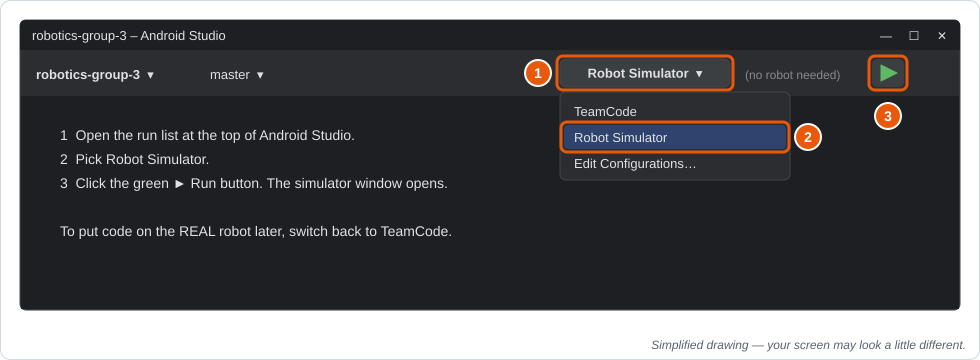
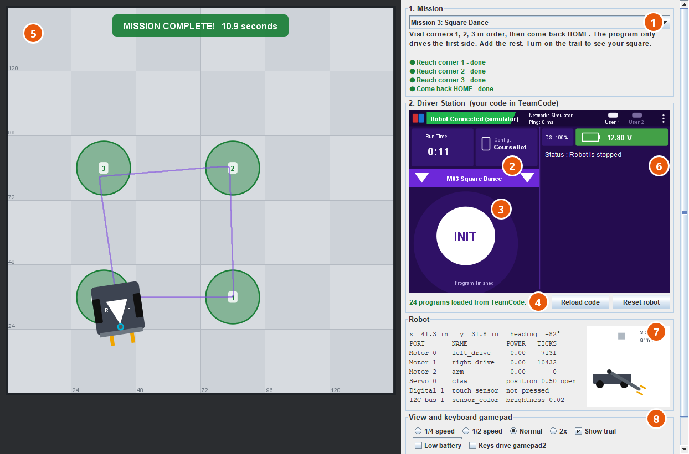
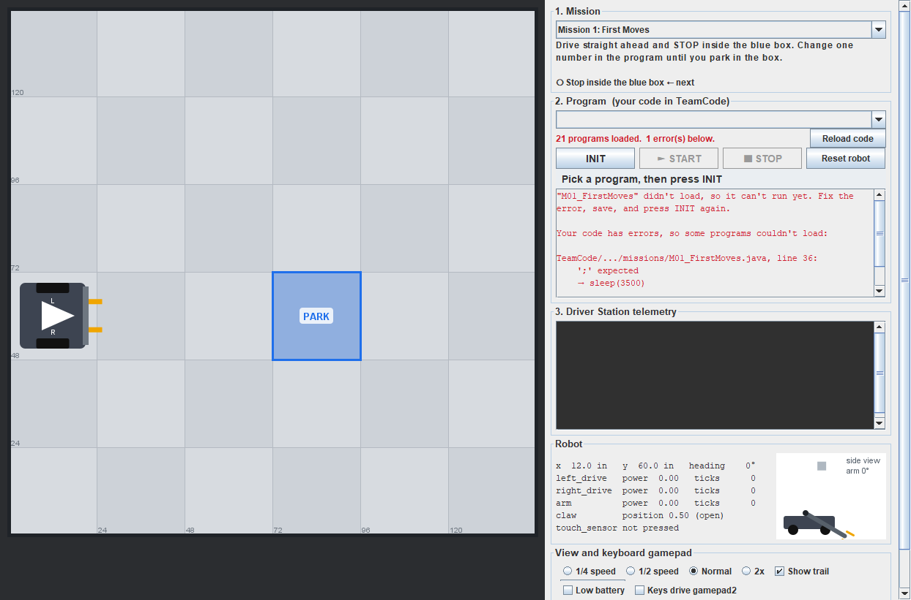
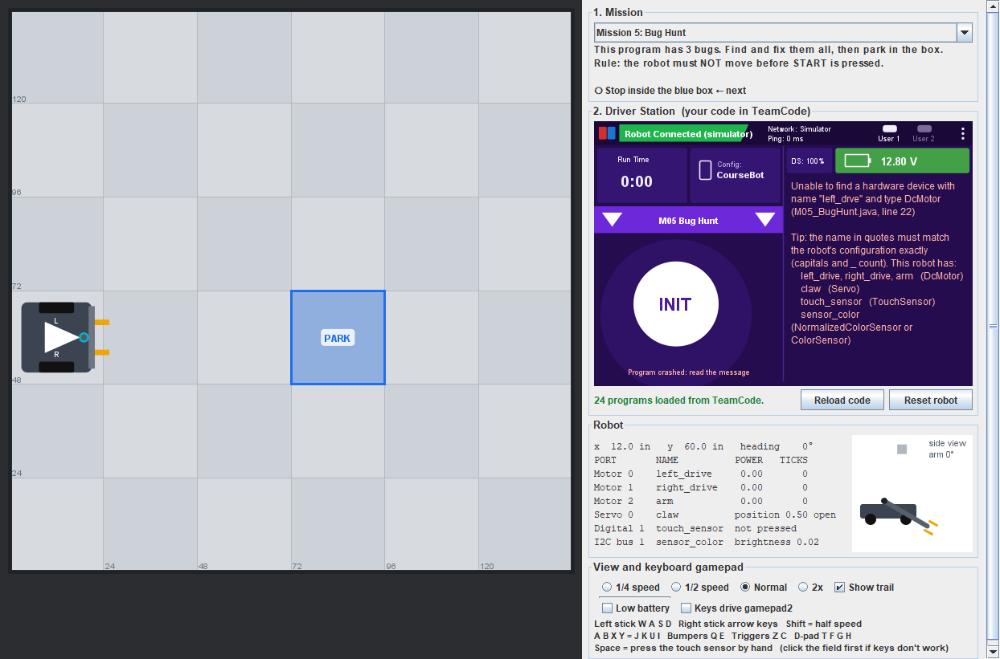

# 🖥️ The Robot Simulator

The simulator is a robot on your screen. It runs **the same Java code** as the real robot:
`LinearOpMode`, `hardwareMap.get(...)`, `setPower`, `sleep`, `telemetry`, `gamepad1`, encoders,
the servo, and the touch sensor. That means:

- **Everyone can test at the same time.** Every laptop has its own robot, so nobody waits for the Control Hub.
- **You can practice at home.** All you need is Android Studio and your group's code.
- **Your code moves to the real robot unchanged.** When it works in the simulator, put it on
  the robot the normal way ([Lesson 00, Step 8](lessons/00-getting-the-code.md#step-8--put-it-on-the-robot-take-turns)).

All 17 lessons and the first-day missions run in it.

---

## Start the simulator

1. Open the run list at the top of Android Studio (it usually says **TeamCode**).
2. Pick **Robot Simulator**.
3. Click the green **▶ Run** button. The simulator window opens. The first time can take a minute.

No robot, cable, or Wi-Fi needed. To put code on the **real** robot later, switch the list back
to **TeamCode**.

---

## The window

| # | Part | What it does |
|---|---|---|
| 1 | **Mission** | Picks the field. Missions have goals; **Free Drive** is an open field for the lessons. |
| 2 | **Program lists** | Laid out like the real Driver Station. **▼ on the left** lists your Autonomous programs, **▼ on the right** lists your TeleOp programs. Programs hidden on the real robot by `@Disabled` are marked *(hidden on robot)*. |
| 3 | **The big round button** | One button, just like the Driver Hub: **INIT** loads your newest code and runs it up to `waitForStart()`. Then it turns into **▶** (START). While the program runs it's **■** (STOP). The small ■ next to ▶ stops without starting. |
| 4 | **Reload code** / **Reset robot** | Reload picks up new files. Reset puts the robot back at the start. (Both are also in the **⋮** menu, next to **Configure Robot**.) |
| 5 | **Field** | Seen from above. Tiles are 24 inches. The white arrow shows the front; **L** and **R** mark the wheels. The bumper turns red when the touch sensor is pressed. |
| 6 | **Telemetry** | Whatever your program sends with `telemetry.update()`, on the right side like the real Driver Station. Error messages show up here too, in pink. **Run Time** counts from START. |
| 7 | **Robot** | Live numbers: position, motor powers, encoder ticks, the claw, the touch sensor, and a side view of the arm. |
| 8 | **View** | Slow motion, the trail (a line showing where the robot went), a **Low battery** switch (the Driver Station's battery turns orange), and the keyboard gamepad keys. |

---

## The everyday loop: edit, INIT, watch
1. Edit your file in Android Studio. It saves by itself (or press **Ctrl+S**).
2. Click the round **INIT** button. The simulator **reloads your code every time you press
   INIT**, so you never have to restart it.
3. Press **▶** (START) and watch. Change something. Repeat.

**If your code has a mistake**, the simulator tells you which file and which line:

**If your program crashes while running**, you get a message with a tip:

---

## The keyboard is your gamepad
Click the field once so the keys go to the simulator.

| Gamepad | Keys | | Gamepad | Keys |
|---|---|---|---|---|
| Left stick | **W A S D** | | A B X Y | **J K U I** |
| Right stick | **arrow keys** | | Bumpers (left, right) | **Q E** |
| Half-way on a stick | hold **Shift** | | Triggers (left, right) | **Z C** |
| D-pad (up, left, down, right) | **T F G H** | | Start / Back | **Enter / Backspace** |
| Press the touch sensor by hand | **Space** | | | |

W gives `left_stick_y = -1.0`, just like pushing a real stick up. Keys can only be all the way,
half-way (with Shift), or not pressed, so sticks can't do the in-between values a real
stick can. To control **gamepad2** (a second driver), tick **Keys drive gamepad2**.

---

## The simulated robot
The simulated robot is wired like the course robot, and its **CourseBot** configuration uses the
course's device names, so your code doesn't change. The Robot panel shows each device's **port**
next to its name, just like the real Control Hub
([where the names come from](reference/robot-configuration.md)).

**Configure Robot** (in the Driver Station's **⋮** menu, or click the **Config** tile) has the
same screens as the real Driver Station. Change a name there and your programs must use the new
name, exactly like on a real robot. **Restore CourseBot** puts everything back
([practice ideas](reference/robot-configuration.md#practice-in-the-simulator)).

| Name in code | Device | In the simulator |
|---|---|---|
| `left_drive` | DcMotor | Left wheel. Mounted mirrored, so programs reverse it (like the real robot). |
| `right_drive` | DcMotor | Right wheel. |
| `arm` | DcMotor | Swings from 0° (down) to 100° (up). With `FLOAT`, gravity slowly pulls it down; `BRAKE` holds it. |
| `claw` | Servo | Opens above position 0.5, closes below. Closing next to a yellow block grabs it. |
| `touch_sensor` | TouchSensor | Pressed when the **front bumper touches a wall**, when the **arm is at the top**, or when you hold **Space**. |
| `sensor_color` | NormalizedColorSensor / ColorSensor | A REV Color Sensor V3 at the front, looking down. Gray tiles read about **0.28** brightness at gain 15, black tape about **0.04**, white tape about **0.80**. Readings wiggle a little, like a real sensor. |

Motors use the numbers from Lesson 12: 537.7 ticks per motor turn, 96 mm wheels, about 45.3
ticks per inch. Top speed is about 40 inches per second at full power.

---

## Lessons in the simulator
Pick a lesson program (your copy, or the original) and the simulator switches to the **Free
Drive** field: the robot faces a wooden wall, with a yellow block right in front of the claw.

| Lesson | What to do in the simulator |
|---|---|
| 01, 03 | Watch the telemetry on the right of the Driver Station. The Break-It Lab errors show up there too. |
| 02, 09, 11 | Turn on the trail and watch the path. Try **Low battery**: timed driving falls short. |
| 04 | Push keys and watch the numbers change. |
| 05 | Tank drive: **W/S** for the left wheels, **↑/↓** for the right wheels. |
| 06, 07 | Arcade: **W/S** to drive, **←/→** to turn. Lesson 07: D-pad is **T F G H**, precision mode is **Q**. |
| 08 | **I** (Y) raises the arm, **J** (A) lowers it. Watch the side view and the top limit. |
| 10, 14 | The robot drives into the wooden wall and the bumper stops it. Press **Space** to "bump" early. |
| 12 | Encoder drive. Tiles are 24 inches, so the first move should end exactly one tile ahead. Turn on **Low battery**: it still goes the right distance. |
| 13 | Tap **J** (A) to toggle the claw. Closing it next to the block picks the block up. |
| 15 | **W/S** drive, **←/→** turn, **Q** precision, **I/J** arm, **K** (B) claw. |
| 16 | The block starts in the claw. Watch the robot carry it and drop it. Tune the turn. |
| 17 | `L17_StopAtTape` opens **Mission 7** (the tape moves every reset, so only the sensor works). `L17_FollowTape` opens **Mission 8**. Watch the sensor's dot turn dark over the tape. |

---

## Practice at home
Your home laptop is just one more laptop in your group.

1. Install [Android Studio](https://developer.android.com/studio) and [GitHub Desktop](https://desktop.github.com) (both free).
2. In GitHub Desktop, sign in and **clone your group's repo**, like [Lesson 00, Step 4](lessons/00-getting-the-code.md#step-4--everyone-clone-the-group-repo).
3. Open the folder in Android Studio and wait for **Gradle sync** to finish (the first time takes a while).
4. Pick **Robot Simulator** and click **▶ Run**.

**Keep your work in sync:**
- Before you leave class: **commit and push**.
- When you start at home: **pull**. When you finish at home: **commit and push**.
- Back in class: **pull** before you do anything else.

---

## What's different from the real robot
The simulator is great for learning and testing, but it's a simplified robot:
- The physics are simple: no wheel slip, no bumpy floors, and every run is nearly the same.
  The real robot will need tuning (turn times, distances), and that's normal.
- Only the six devices above exist. Code for other hardware (IMU, distance sensor, camera,
  `DcMotorEx`, and so on) won't load in the simulator. Put files like that in a folder named
  **`robotonly`** inside your folder, and the simulator will skip them.
- A real gamepad doesn't work yet; use the keyboard.
- The simulator loads code from three TeamCode folders: `lessons`, `missions`, and `students`.

## Troubleshooting
| Problem | Fix |
|---|---|
| **Robot Simulator** isn't in the run list | Pull the latest code, then **File → Sync Project with Gradle Files**. |
| My program isn't in the list | Check the other ▼ list: Autonomous is on the left, TeleOp on the right. Is it in your `students/yourname` folder? Did the simulator show an error for it? Press **INIT** or **Reload code** after saving. |
| Keys don't move the robot | Click the field once, then try again. The program must be running (after ▶ START). **User 1** at the top lights up while keys are held. |
| "didn't load, so it can't run yet" | Read the error under it: it gives the file and line. Fix it, save, press INIT. |
| The robot says **BLOCKED** | It's pushing on a wall. Square robots can't spin right next to a wall, so back up first. |
| "still running after STOP" | One of your loops doesn't check `opModeIsActive()`. |
| Every program says *Unable to find a hardware device* | Someone changed the robot configuration. **⋮ → Configure Robot → Restore CourseBot**. |

---
👩‍🏫 **For teachers:**
- The simulator lives in the `simulator/` folder and is never part of the robot app. Choosing
  **TeamCode** and pressing ▶ builds and deploys the robot app exactly as before.
- If a Gradle sync ever fails because of the simulator, robot deploys don't need it: delete the
  line `include ':simulator'` from `settings.gradle` and sync again.
- When you merge a new FTC SDK release into your fork, `settings.gradle` and the front-page
  README may conflict. Keep both sides: FIRST's changes plus the simulator line and the
  "Students: start here" box.
- Fields and goals are defined in `simulator/src/main/java/robotsim/Missions.java`, so you can
  add your own.
